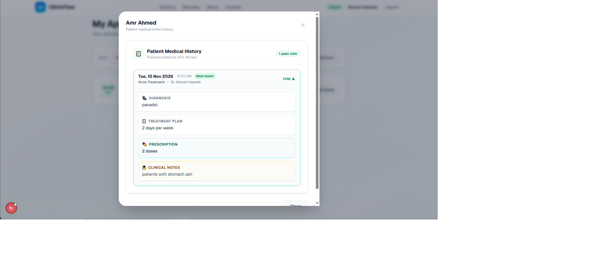

# ClinicFlow

A full-stack clinic appointment and patient management platform. Patients book online, the secretary runs daily operations, and doctors record consultation notes, with automatic emails at every step.

Built to model a real clinic's workflow rather than a generic CRUD app: business rules are enforced in the backend, and each role only sees what it should.

## Screenshots

### From booking to consultation

| 1. Selection is kept before login | 2. Appointment requested |
|---|---|
|  |  |

| 3. Patient receives request email | 4. Secretary receives the request |
|---|---|
|  |  |

| 5. Secretary actions after confirming | 6. Patient gets confirmation email |
|---|---|
|  |  |

| 7. Doctor appointments dashboard | 8. Quick-view past notes modal |
|---|---|
|  |  |

| 9. Doctor consultation & patient history | 10. Patient appointments portal |
|---|---|
|  |  |

<details>
<summary>More screenshots (Authentication & Password Reset)</summary>

| Login | Forgot password |
|---|---|
|  |  |

| Verification code email | |
|---|---|
|  | |

</details>

## Features

### Patients
- Browse doctors, specialties, and clinic services publicly without requiring an account
- Guided booking flow (doctor, service, date, time slot) where the selection survives the login/register redirect
- Patient dashboard with tabbed appointments (`Upcoming`, `Past`, `Cancelled`)
- Cancel upcoming appointments directly from the dashboard with an optional cancellation reason
- Profile management (update contact info, change password)
- Self-service password recovery via emailed 6-digit verification code

### Secretary (Clinic Administration)
- **Appointment Operations**: Full view of all appointments across the clinic with date, doctor, and status filters; controlled lifecycle transitions (`confirm`, `check_in`, `complete`, `no_show`, `cancel`); add internal operational notes on appointment cards
- **Doctor Management**: Add new doctors with full profiles (specialty, bio, consultation fee, default duration, initial password); assign offered services; configure custom weekly working hours per day (start/end times and enabled days); toggle doctors active or inactive
- **Services Catalog**: Create and maintain clinic services with custom pricing and duration in minutes; toggle availability on/off
- **Patient Directory**: Searchable, paginated registry of all registered patients with contact details, registration dates, and total visit counts
- **Lead Pipeline (CRM)**: Manage incoming patient inquiries through a 6-stage lifecycle (`new` -> `contacted` -> `interested` -> `appointment_booked` -> `closed` -> `lost`), maintain internal notes, and convert leads directly into booked appointments

### Doctors
- Dedicated appointments view with date and status filters
- **Quick-view Past Notes modal**: 1-click preview of a patient's entire medical history directly from the appointments list
- **Consultation View**: Responsive side-by-side workspace with current clinical note editor on the left and full **Patient Medical History** on the right
- **1-Click Copy Shortcuts**: Quickly carry forward prior diagnoses, treatment plans, or prescriptions into the current consultation form without retyping
- Structured records: Diagnosis, Treatment Plan, Prescription, and Private Clinical Notes (enforced server-side: readable only by doctors)

### Automated Notifications (Brevo REST API)
- **Appointment Requested**: Confirmation email to the patient and instant notification to the clinic secretary
- **Appointment Confirmed**: Notification email to the patient with clinic visit details
- **Appointment Cancelled**: Cancellation confirmation to the patient (including reason)
- **Day-Before Reminder**: Automated daily scheduled script (`backend/cron/send_reminders.php`) to remind patients of tomorrow's appointments
- **Password Reset**: Secure one-time 6-digit verification code email

## Business rules enforced in the backend

- **Double-booking prevention**: Concurrency control using MySQL row-level locking (`FOR UPDATE`) within a transaction, combined with a unique database constraint on `(doctor_id, appointment_date, appointment_time)` as a safety net
- **Valid booking window**: Bookings cannot be in the past; only active doctors with active services during their configured working hours can be booked
- **Strict role-based authorization**: Every sensitive endpoint validates authentication, role, and record ownership (e.g., only secretaries manage doctors/services/leads; only doctors write consultation notes; patients can only view and cancel their own appointments)
- **Controlled state machine**: Appointments strictly follow valid status transitions (e.g., `completed` cannot be cancelled; `no_show` only applies to `confirmed` appointments)
- **Doctor active/inactive status**: Deactivating a doctor immediately hides them from new public bookings while preserving all historical appointments and consultation notes
- **Cancellation slot release**: Cancelled appointments are preserved as audit records, and their time slot is immediately released for new bookings
- **Secure password reset**: SHA-256 hashed code storage, 10-minute expiration, 60-second request cooldown, and maximum 5 failed attempts before code invalidation

## REST API Overview

| Resource | Method | Path | Auth / Role | Description |
|---|---|---|---|---|
| **Auth** | `POST` | `/auth/register` | Public | Register new patient account |
| | `POST` | `/auth/login` | Public | Authenticate user & start session |
| | `GET` | `/auth/me` | Logged in | Get current user profile |
| | `POST` | `/auth/logout` | Logged in | End session & clear cookie |
| | `PATCH` | `/auth/profile` | Logged in | Update name, phone, or password |
| | `POST` | `/auth/forgot-password` | Public | Send 6-digit password reset code |
| | `POST` | `/auth/verify-code` | Public | Validate password reset code |
| | `POST` | `/auth/reset-password` | Public | Reset password with verified code |
| **Appointments** | `GET` | `/appointments/slots` | Public | Available time slots for doctor + service + date |
| | `GET` | `/appointments` | Patient / Dr / Sec | Role-filtered appointment list |
| | `GET` | `/appointments/:id` | Patient / Dr / Sec | Single appointment details |
| | `POST` | `/appointments` | Patient / Sec | Book new appointment (with row lock) |
| | `PATCH` | `/appointments/:id` | Patient / Sec | Cancel (patient) or state transition (secretary) |
| **Consultations** | `GET` | `/consultations` | Doctor | Notes for a specific appointment |
| | `GET` | `/consultations/history` | Doctor | Patient's previous clinic consultation history |
| | `POST` | `/consultations` | Doctor | Upsert diagnosis, treatment, prescription, notes |
| **Doctors** | `GET` | `/doctors` | Public | List all active doctors & offered services |
| | `GET` | `/doctors/:id` | Public | Doctor profile, bio, services & working hours |
| | `POST` | `/doctors` | Secretary | Create doctor account, profile, hours & services |
| | `PATCH` | `/doctors/:id` | Secretary | Update profile, toggle active, update hours/services |
| **Services** | `GET` | `/services` | Public | List all active clinic services |
| | `GET` | `/services/:id` | Public | Single service detail |
| | `POST` | `/services` | Secretary | Create new clinic service |
| | `PATCH` | `/services/:id` | Secretary | Update service or toggle active status |
| **Patients** | `GET` | `/patients` | Secretary | Paginated patient registry with search |
| | `GET` | `/patients/:id` | Secretary | Patient profile & appointment history summary |
| **Leads** | `POST` | `/leads` | Public | Submit contact form inquiry |
| | `GET` | `/leads` | Secretary | List and filter leads by status |
| | `GET` | `/leads/:id` | Secretary | Lead details & internal notes |
| | `PATCH` | `/leads/:id` | Secretary | Update lead status (`new` → `closed`) and notes |
| | `POST` | `/leads/:id/convert` | Secretary | Convert lead into a booked appointment |

## Tech stack

| Layer | Technology |
|---|---|
| Frontend | Next.js (App Router), React, TypeScript, Tailwind CSS |
| Backend | PHP (REST API), PDO |
| Database | MySQL |
| Auth | PHP sessions, `password_hash` / `password_verify` |
| Email | Brevo REST API |

## Architecture

```text
Browser -> Next.js (:3000) -- /api/* rewrite --> PHP front controller (:8000) -> MySQL
                                                  public/index.php -> api/<resource>.php
```

- The frontend and backend are fully decoupled and talk JSON over HTTP
- Next.js proxies `/api/*` to PHP, so the browser sees one origin (simple cookies)
- `backend/public/index.php` is the only web-facing file. It handles errors, CORS, sessions, and routing to `backend/api/*.php`. Config, `.env`, and shared code stay outside the web root

```text
backend/
├── public/index.php      # front controller
├── config/               # .env loader, PDO connection
├── api/                  # one file per resource (auth, doctors, services, appointments, consultations, ...)
├── helpers.php           # JSON responses and shared helpers
├── mail.php              # Brevo client and email templates
├── cron/                 # scheduled scripts (reminders)
└── database/             # schema.sql, seed.sql

frontend/
├── app/                  # routes: public pages, auth, patient, doctor, secretary
├── components/           # reusable UI
└── types/
```

## Getting started

### Prerequisites
- PHP 8.1+ with the `curl` and `pdo_mysql` extensions
- MySQL 5.7+ or MariaDB 10.3+ (XAMPP works)
- Node.js 18+

### 1. Database
Import both files with phpMyAdmin or the MySQL CLI, in this order:
```bash
mysql -u root < backend/database/schema.sql
mysql -u root < backend/database/seed.sql
```

### 2. Backend
```bash
cd backend
cp .env.example .env      # then fill in your values (see below)
php -S localhost:8000 -t public
```

Set these in `backend/.env`: database credentials, and for emails a Brevo API key, a verified sender address in `MAIL_FROM_EMAIL`, and `SECRETARY_EMAIL`. Without a Brevo key the app still runs, but emails are skipped (the error appears in the PHP log).

### 3. Frontend
```bash
cd frontend
npm install
npm run dev
```
Open http://localhost:3000. The `/api/*` proxy points to `http://localhost:8000`.

### Demo accounts
See `backend/database/seed.sql` for the seeded doctor, secretary, and patient accounts and their demo passwords.

### Reminder emails
Run `php backend/cron/send_reminders.php` to send tomorrow's reminders. In production, schedule it once a day (cron on Linux, Task Scheduler on Windows).

## Security measures implemented

- PDO prepared statements, no string-built SQL with user input
- Password hashing, and the role is never accepted from the client (registration always creates a patient)
- Session ID regeneration on login (session fixation), HttpOnly and SameSite cookies
- Server-side authorization on every sensitive endpoint: authentication, role, and ownership of the specific record
- Same response for known and unknown emails in password reset, hashed one-time codes with expiry, attempt limit, and cooldown
- Strict CORS origin, security headers, and database errors never exposed to users
- Secrets only in `.env` (never committed)

Not claiming the system is completely secure. See the roadmap for what is still planned.

## Roadmap

- [x] Contact form capturing public leads with a 6-stage pipeline for the secretary (`new` → `closed`)
- [x] Full secretary administration suite: manage doctors, weekly working hours, clinic services, and patients registry
- [x] Doctor consultation workspace with side-by-side past medical history & 1-click copy helpers
- [x] Transactional email automation via Brevo REST API (booking requests, confirmations, cancellations, reminders, and password reset codes)
- [ ] Direct appointment rescheduling from the patient and secretary dashboards
- [ ] CSRF token verification and API rate limiting on authentication routes
- [ ] Refactor repeated frontend `fetch` calls into a shared HTTP client
- [ ] Multi-language support (English / Arabic)

## Author

Amr Ahmed, [GitHub](https://github.com/amr1588)
