# ClinicFlow

A full-stack clinic appointment and patient management platform. Patients book online, the secretary runs daily operations, and doctors record consultation notes, with automatic emails at every step.

Built to model a real clinic's workflow rather than a generic CRUD app: business rules are enforced in the backend, and each role only sees what it should.

## Screenshots

### From booking to consultation

| 1. Selection is kept before login | 2. Back at the booking after login |
|---|---|
| 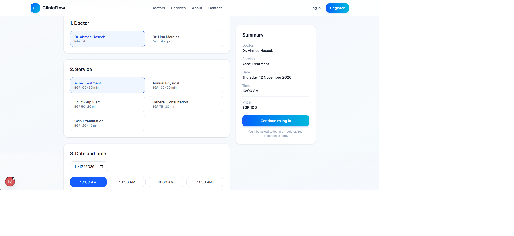 | 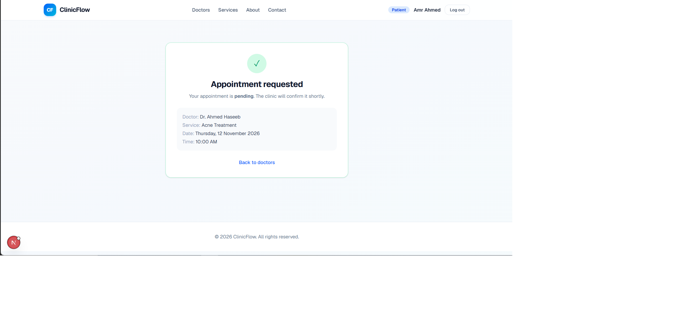 |

| 3. Secretary receives the request | 4. Secretary actions after confirming |
|---|---|
| 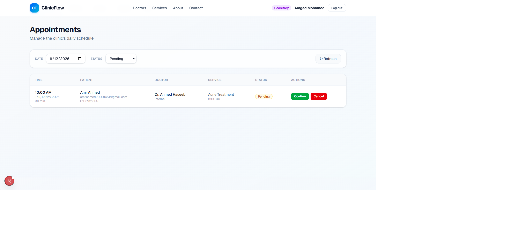 | 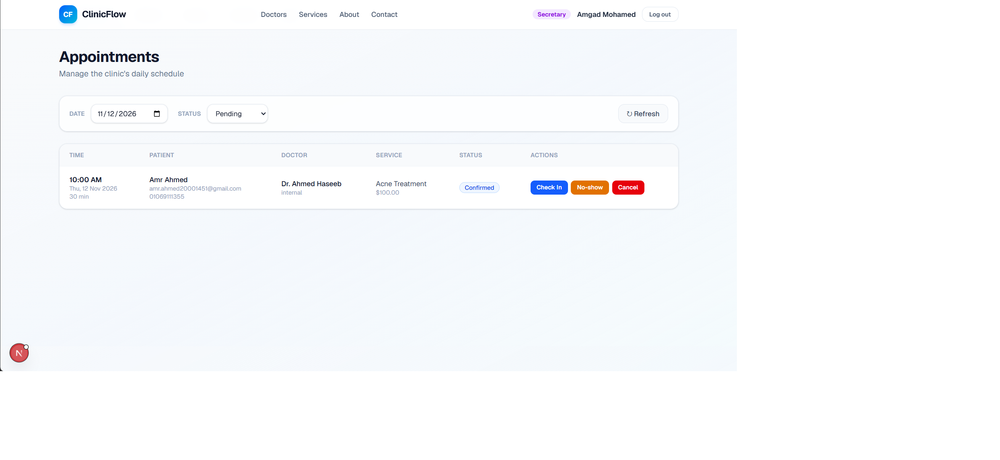 |

| 5. Patient gets the confirmation email | 6. Doctor adds notes and sees patient history |
|---|---|
| 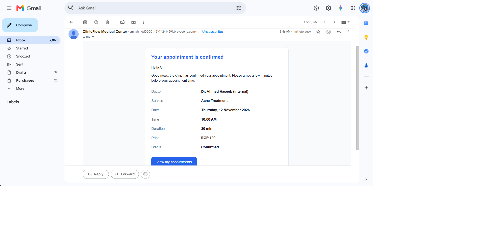 | 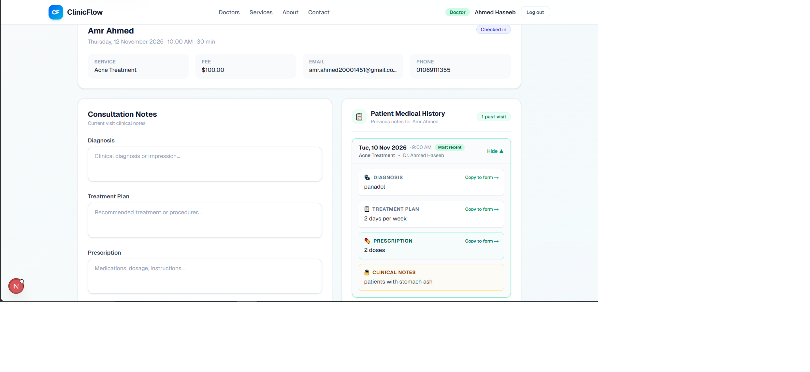 |

<details>
<summary>More screenshots (6)</summary>

| Patient appointments | Doctor appointments |
|---|---|
| 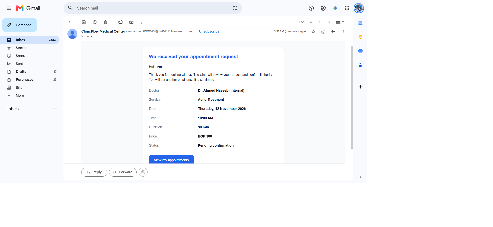 |  |

| Doctor notes view | Login |
|---|---|
| 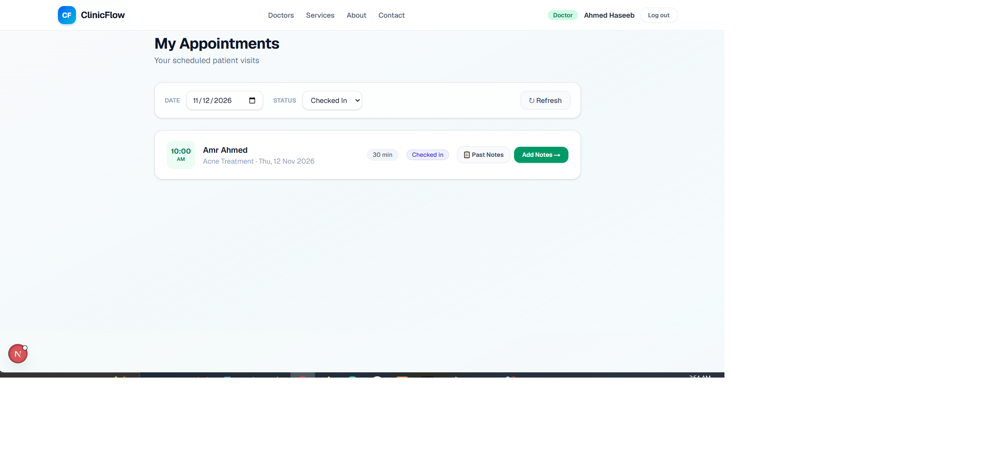 | 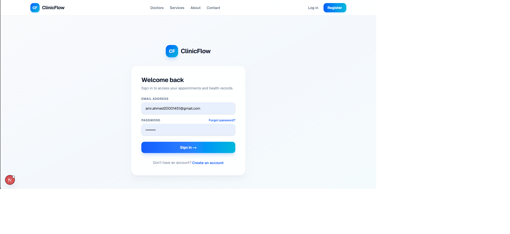 |

| Forgot password | Verification code email |
|---|---|
| 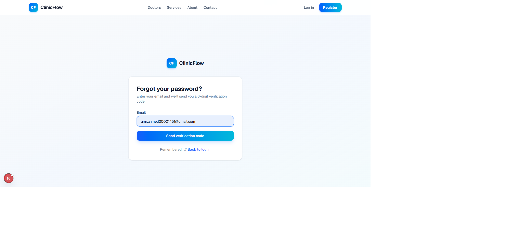 | 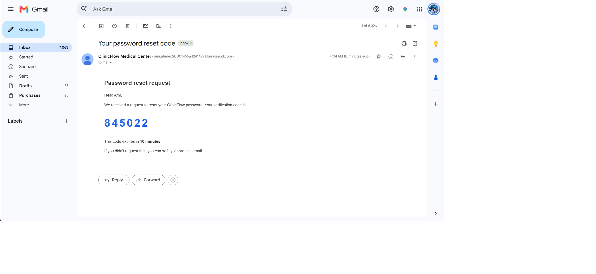 |

</details>

## Features

**Patients**
- Browse doctors and services without an account
- Book in a guided flow (doctor, service, date, time). The selection survives the login/register redirect
- View upcoming, past, and cancelled appointments, and cancel their own
- Edit their profile and reset a forgotten password with an emailed code

**Secretary**
- See and filter all appointments
- Confirm, check in, complete, mark no-show, or cancel through a controlled status lifecycle

**Doctors**
- See their own appointments
- Write consultation notes (diagnosis, treatment, prescription, private notes)
- See the same patient's previous visit notes when opening a new appointment

**Automation (Brevo transactional email)**
- Appointment request: confirmation to the patient, notification to the secretary
- Appointment confirmed and cancelled notices
- Reminder the day before (scheduled script)
- Password reset code

## Business rules enforced in the backend

- A doctor can never be double-booked, including overlapping times (transaction with a row lock, plus a unique constraint as a safety net)
- No bookings in the past, only active doctors, and only services that doctor offers
- The slot is re-validated when the booking is confirmed
- Status transitions follow a state machine (for example, a cancelled appointment cannot become completed)
- Patients can only see and cancel their own appointments (ownership is checked on the server)
- Consultation notes are readable only by the owning doctor, never by patients or the secretary
- Cancelled appointments are kept as records. Their time slot becomes available again

## Tech stack

| Layer | Technology |
|---|---|
| Frontend | Next.js (App Router), React, TypeScript, Tailwind CSS |
| Backend | PHP (REST API), PDO |
| Database | MySQL |
| Auth | PHP sessions, `password_hash` / `password_verify` |
| Email | Brevo REST API |

## Architecture

```text
Browser -> Next.js (:3000) -- /api/* rewrite --> PHP front controller (:8000) -> MySQL
                                                  public/index.php -> api/<resource>.php
```

- The frontend and backend are fully decoupled and talk JSON over HTTP
- Next.js proxies `/api/*` to PHP, so the browser sees one origin (simple cookies)
- `backend/public/index.php` is the only web-facing file. It handles errors, CORS, sessions, and routing to `backend/api/*.php`. Config, `.env`, and shared code stay outside the web root

```text
backend/
├── public/index.php      # front controller
├── config/               # .env loader, PDO connection
├── api/                  # one file per resource (auth, doctors, services, appointments, consultations, ...)
├── helpers.php           # JSON responses and shared helpers
├── mail.php              # Brevo client and email templates
├── cron/                 # scheduled scripts (reminders)
└── database/             # schema.sql, seed.sql

frontend/
├── app/                  # routes: public pages, auth, patient, doctor, secretary
├── components/           # reusable UI
└── types/
```

## Getting started

### Prerequisites
- PHP 8.1+ with the `curl` and `pdo_mysql` extensions
- MySQL 5.7+ or MariaDB 10.3+ (XAMPP works)
- Node.js 18+

### 1. Database
Import both files with phpMyAdmin or the MySQL CLI, in this order:
```bash
mysql -u root < backend/database/schema.sql
mysql -u root < backend/database/seed.sql
```

### 2. Backend
```bash
cd backend
cp .env.example .env      # then fill in your values (see below)
php -S localhost:8000 -t public
```

Set these in `backend/.env`: database credentials, and for emails a Brevo API key, a verified sender address in `MAIL_FROM_EMAIL`, and `SECRETARY_EMAIL`. Without a Brevo key the app still runs, but emails are skipped (the error appears in the PHP log).

### 3. Frontend
```bash
cd frontend
npm install
npm run dev
```
Open http://localhost:3000. The `/api/*` proxy points to `http://localhost:8000`.

### Demo accounts
See `backend/database/seed.sql` for the seeded doctor, secretary, and patient accounts and their demo passwords.

### Reminder emails
Run `php backend/cron/send_reminders.php` to send tomorrow's reminders. In production, schedule it once a day (cron on Linux, Task Scheduler on Windows).

## Security measures implemented

- PDO prepared statements, no string-built SQL with user input
- Password hashing, and the role is never accepted from the client (registration always creates a patient)
- Session ID regeneration on login (session fixation), HttpOnly and SameSite cookies
- Server-side authorization on every sensitive endpoint: authentication, role, and ownership of the specific record
- Same response for known and unknown emails in password reset, hashed one-time codes with expiry, attempt limit, and cooldown
- Strict CORS origin, security headers, and database errors never exposed to users
- Secrets only in `.env` (never committed)

Not claiming the system is completely secure. See the roadmap for what is still planned.

## Roadmap

- [ ] CSRF protection and login/register rate limiting
- [ ] Contact form that captures leads, with a lead pipeline for the secretary (new, contacted, interested, booked, closed)
- [ ] Full secretary dashboard: patients, doctors, services, and working hours management
- [ ] Rescheduling appointments
- [ ] Refactor repeated `fetch` calls into a shared API client
- [ ] Optional: one external CRM integration

## Author

Amr Ahmed, [GitHub](https://github.com/amr1588)
